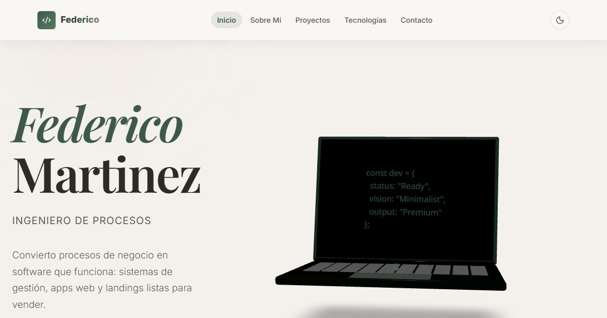

# Portafolio de Federico Martinez

Portafolio personal, publicado en **https://portafolio-federico.vercel.app/**



## Qué tiene

- **Inicio** con un laptop 3D interactivo (en celular entra primero una imagen y el 3D la reemplaza al interactuar).
- **Proyectos:** carrusel de sitios en vivo con vista de escritorio y de celular, lista de proyectos de código, y un espacio propio para [Nimbo](https://github.com/FedericoChalaca/nimbo).
- **Tecnologías:** cada una dice para qué le sirve a un cliente y en qué proyecto real se usó.
- **Contacto** con WhatsApp, correo, GitHub y LinkedIn.
- Modo claro y oscuro, y respeto a la preferencia de movimiento reducido.

## Tecnologías

- **Base:** React 19, TypeScript, Vite.
- **3D y animación:** Three.js, @react-three/fiber, @react-three/drei, Framer Motion.
- **Estilos:** CSS propio con variables (tokens) en `src/index.css`.
- **Iconos:** Lucide React.
- **Fuentes:** Inter y Playfair Display, servidas desde el propio sitio.

## Dónde se cambia el contenido

Todo el contenido vive en `src/data/portfolio.ts`: datos personales, proyectos, Nimbo y tecnologías. Las secciones están en `src/sections/` y los componentes en `src/components/`.

Las capturas del carrusel están en `public/previews/` (escritorio 960x600 y celular 390x844, en WebP). Un proyecto aparece en el carrusel solo si tiene `previews`; si no, va a la lista de "Más proyectos".

## Desarrollo

```bash
npm install
npm run dev
```

```bash
npm run build
npm run lint
```

## Publicación

El proyecto está conectado a Vercel: cada `git push` a `master` publica el sitio. Las cabeceras de seguridad (CSP y demás) y la caché están en `vercel.json`.

## Licencia

Este proyecto está bajo la Licencia MIT.
